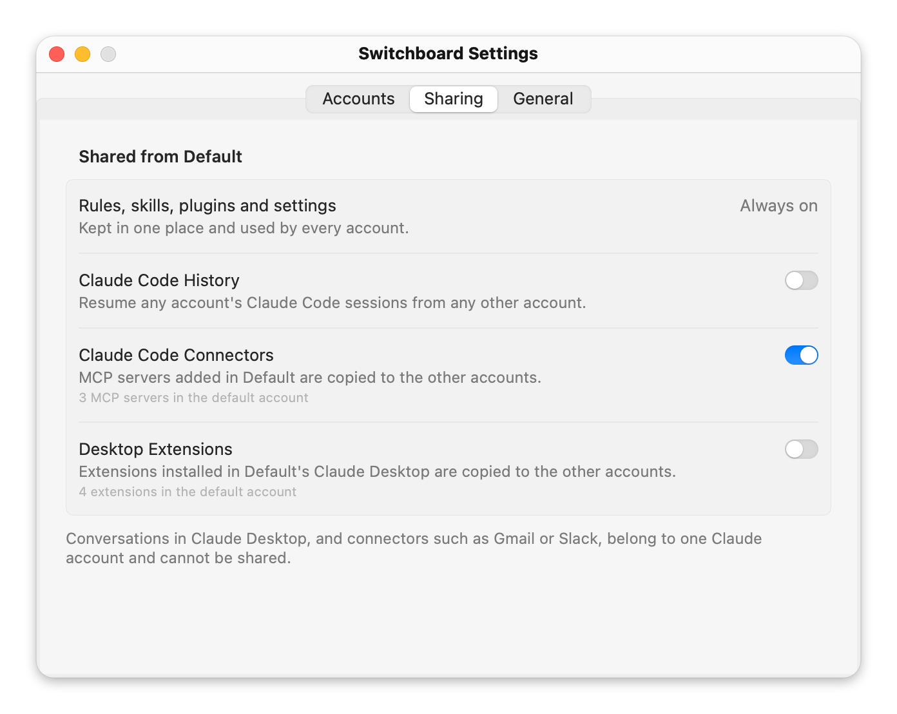

<p align="center"></p>

<h1 align="center">Switchboard</h1>

<p align="center"><b>Use all your Claude accounts at once on one Mac.</b><br>
A menu bar app for Claude Desktop and Claude Code.</p>

<p align="center">
  
</p>
<p align="center">
  
</p>

## Why

Claude's apps hold one account at a time. If you have a work account and a personal one, switching means signing out and back in, and you can never have both open.

Switchboard gives each account its own Claude Desktop window and its own Claude Code sign-in. They run side by side, and you move between them from the menu bar.

## Features

- **Every account, one click away.** Open any account's Claude Desktop or Claude Code from the menu. A green dot shows which are running.
- **Truly side by side.** Each account has its own sign-in, chats and projects. Nothing is signed out to make room.
- **One shared setup.** Your `CLAUDE.md`, rules, agents, skills, hooks and settings apply to every account, from one place.
- **Share more if you want.** Switches in Settings share Claude Code sessions, MCP servers and Desktop extensions between accounts.
- **Per-project accounts.** Pin a folder to an account, and `claude` uses it there.
- **A command-line twin.** `cprof` does everything the menu does, for scripts and terminals.
- **Leaves your setup alone.** Your current Claude becomes the "Default" account. Switchboard never moves or changes it.

## Install

**Homebrew**

```bash
brew install --cask haffaz/tap/switchboard
```

This also puts `cprof` on your `PATH`. If Homebrew says the tap is not trusted, run `brew trust haffaz/tap` and install again.

**Download**

Get the latest `Switchboard.dmg` from [Releases](https://github.com/Haffaz/switchboard/releases), open it, and drag Switchboard to Applications. It is signed and notarized, so it opens without a warning.

### Build from source

Needs macOS 14 or later and Xcode 16 or later.

```bash
git clone https://github.com/Haffaz/switchboard.git
```

```bash
cd switchboard && ./build.sh --install
```

## Get started

1. Click the two-cog icon in your menu bar and choose **Add Account…**.
2. Type a name, such as "Work".
3. Sign in in the Claude window that opens.

That's it. Click an account to open its Claude Desktop, or point at it for Claude Code. Renaming, icons and sharing are in **Settings**. The [getting started guide](docs/getting-started.md) has pictures of each step.

## How it works

Switchboard does not modify Claude. It starts Claude's own apps so that each account gets separate storage:

| | Kept separate by |
|---|---|
| **Claude Code** | its `CLAUDE_CONFIG_DIR` setting, one folder per account |
| **Claude Desktop** | a separate copy of the app with its own data folder |

Your shared setup is linked into each account, so it stays in one place. [How it works](docs/how-it-works.md) covers the details, including how sign-in reaches the right window.

## Questions

**Is it safe to use with my accounts?**
Switchboard never reads tokens, passwords or Keychain items, and never stores or logs sign-in codes. It contains no third-party code and makes no network requests of its own. [What it reads](docs/how-it-works.md#what-switchboard-reads) lists everything.

**Will it break my current Claude?**
No. Your existing setup is the Default account. Switchboard only reads it.

**Why does macOS ask to let Switchboard control Claude?**
To bring a specific account's window to the front, and to hand a sign-in to the right window. [Details](docs/how-it-works.md#why-macos-asks-for-permission).

**Could a Claude update break it?**
Possibly. It relies on two behaviours of Claude's apps, described above. If either changes, Switchboard will need an update.

**How do I remove it?**
See [Uninstalling](docs/troubleshooting.md#uninstalling). Your Default account is untouched.

## Documentation

| Guide | What is in it |
|---|---|
| [Getting started](docs/getting-started.md) | Install, add an account, sign in, everyday use |
| [How it works](docs/how-it-works.md) | What is shared, how sign-in is routed, what Switchboard reads |
| [The `cprof` command](docs/cli.md) | Every command, with examples |
| [Troubleshooting](docs/troubleshooting.md) | Fixes for common problems, and how to uninstall |
| [Contributing](CONTRIBUTING.md) | How to report a bug, suggest an idea or send a pull request |
| [Development](docs/development.md) | Project layout, screenshots, making a release |

## Contributing

Bug reports and pull requests are welcome. Switchboard is a small Swift codebase with no dependencies, so it is quick to read. Start with [CONTRIBUTING.md](CONTRIBUTING.md).

## License

MIT. See [LICENSE](LICENSE).

Switchboard is an independent project. It is not made by or affiliated with Anthropic. Claude is a trademark of Anthropic.
