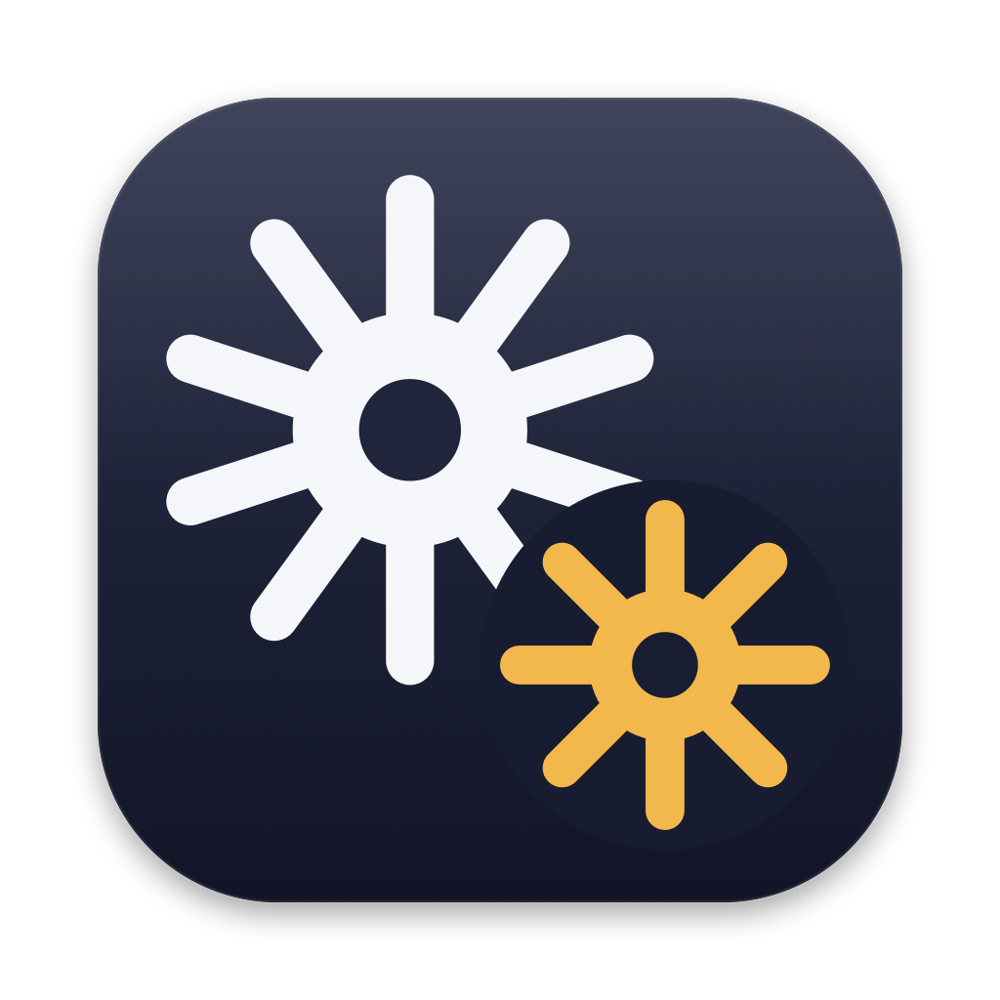
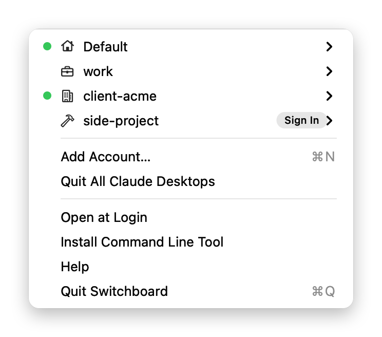

<p align="center"></p>

<h1 align="center">Switchboard</h1>

<p align="center">Run several Claude accounts on one Mac, side by side.</p>

<p align="center">
  
  
</p>

Switchboard is a menu bar app for people who use more than one Claude account, such as a work account and a personal one. Each account gets its own Claude Desktop window and its own Claude Code sign-in, and they all run at the same time. No signing out and back in.

It comes with `cprof`, a command-line tool that does the same things from a terminal.

> Switchboard is an independent project. It is not made by or affiliated with Anthropic.

## What it does

- **One menu for all your accounts.** Open any account's Claude Desktop or Claude Code in a click. A green dot shows which ones are running.
- **Accounts run side by side.** Each has its own sign-in, chat history and projects.
- **Your setup is shared.** Your `CLAUDE.md`, rules, agents, skills, hooks and settings apply to every account, from one place.
- **Sign-in that goes to the right window.** With several Claude copies open, a browser sign-in normally lands in the wrong one. Switchboard routes it to the account you are signing in.
- **Folders can remember their account.** Pin a project folder to an account, and `claude` uses it there.
- **Your existing setup is untouched.** It becomes the "Default" account. Switchboard never moves or changes it.

## Install

There are no downloadable releases yet, so you build it yourself. This takes about a minute.

You need macOS 14 or later and Xcode 16 or later (for Swift 6).

```bash
git clone https://github.com/Haffaz/switchboard.git
```

```bash
cd switchboard && ./build.sh --install
```

That builds **Switchboard.app**, copies it to `/Applications` and opens it. Look for the two-cog icon in your menu bar.

## Quick start

1. Click the menu bar icon and choose **Add Account…**. Type a name such as "Work".
2. Choose **Sign In to Both**. Sign in to Claude Desktop in the window that opens, and to Claude Code in the Terminal window.
3. From then on, click an account to open its Claude Desktop, or point at it for everything else.

The [getting started guide](docs/getting-started.md) walks through each step with pictures.

## Documentation

| Guide | What is in it |
|---|---|
| [Getting started](docs/getting-started.md) | Install, add your first account, sign in, everyday use |
| [How it works](docs/how-it-works.md) | What is shared and what is separate, how sign-in is routed, what Switchboard reads |
| [The `cprof` command](docs/cli.md) | Every command, with examples |
| [Troubleshooting](docs/troubleshooting.md) | Fixes for common problems, and how to uninstall |
| [Contributing](CONTRIBUTING.md) | Build, test, project layout, making a signed release |

## Good to know

- **Sign-in codes are never stored or logged, and Switchboard reads no tokens.** Details are in [How it works](docs/how-it-works.md#what-switchboard-reads).
- **It relies on two behaviours of Claude's apps**: Claude Code's `CLAUDE_CONFIG_DIR` setting, and Claude Desktop accepting a separate data folder. A future Claude update could change either.
- **The app is not sandboxed.** It has to start Claude and manage account folders in your home folder.

## License

MIT. See [LICENSE](LICENSE).
