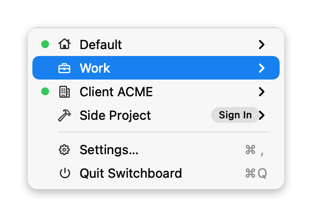
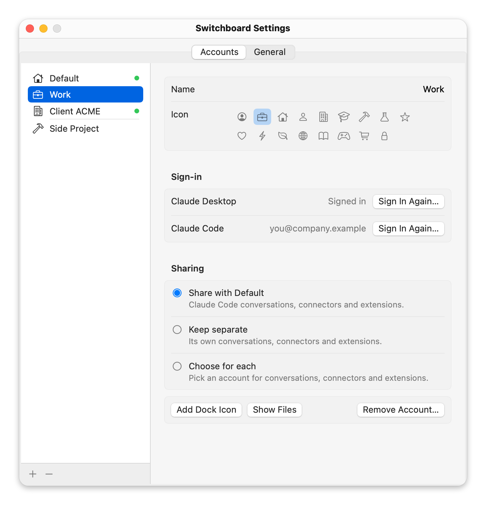
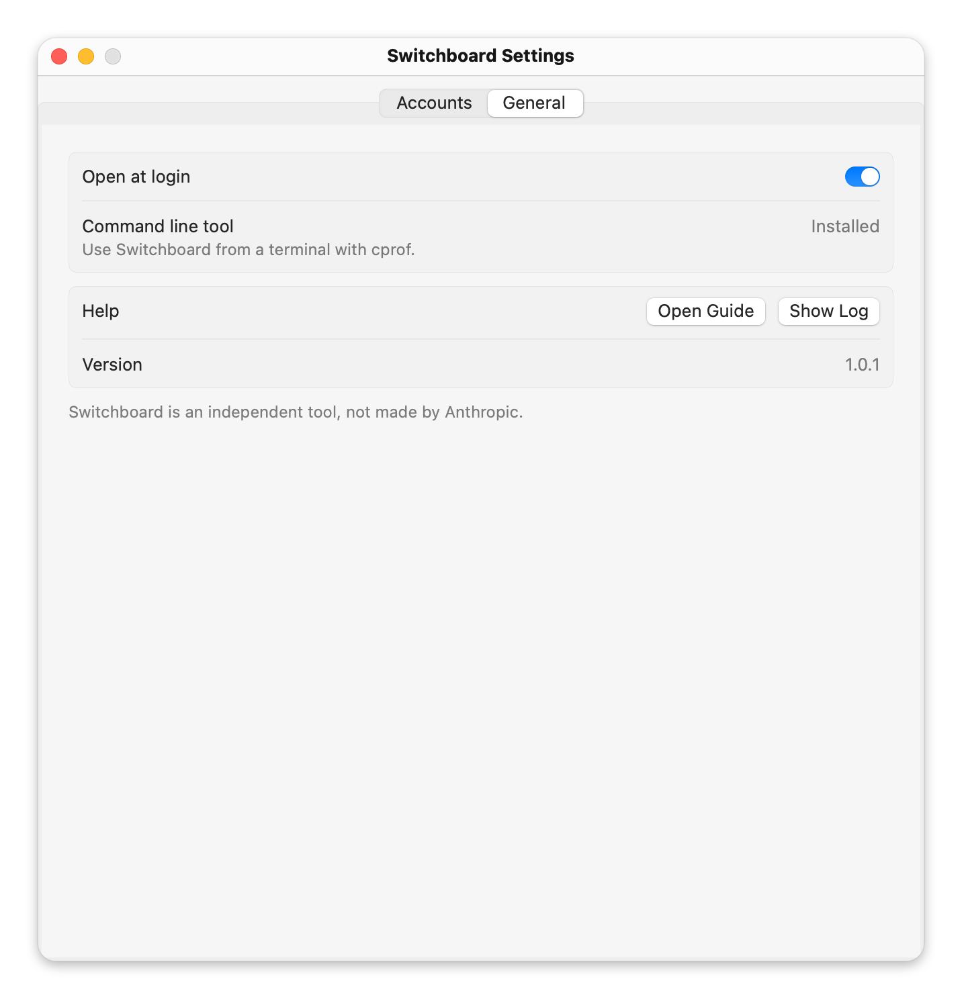

# Getting started

This guide takes you from nothing to two Claude accounts running side by side. It takes about five minutes.

## Before you start

You need:

- macOS 14 or later.
- [Claude Desktop](https://claude.ai/download), [Claude Code](https://claude.com/claude-code), or both.

Your current Claude setup stays exactly as it is. Switchboard lists it as **Default** and never moves or changes it. You can rename it, for example to "Personal".

## 1. Install

Pick one.

**Homebrew**

```bash
brew install --cask haffaz/tap/switchboard
```

If Homebrew says the tap is not trusted, run `brew trust haffaz/tap` and install again.

**Download**

Get `Switchboard-<version>.dmg` from the [Releases page](https://github.com/Haffaz/switchboard/releases), open it, and drag Switchboard to Applications.

**Build from source** (needs Xcode 16 or later)

```bash
git clone https://github.com/Haffaz/switchboard.git
```

```bash
cd switchboard && ./build.sh --install
```

Open Switchboard from Applications if it is not already running. A two-cog icon appears in your menu bar.

To have it there after every restart, open **Settings…** from the menu and switch on **Open at login** in the General tab.

## 2. Add an account

Click the menu bar icon, choose **Settings…**, and click **+** under the account list.

<p align="center"></p>

Type a name, such as "Work", and click **Add**. The name is kept exactly as you type it.

A new account starts the same as your Default account: it shares its Claude Code history, connectors and extensions. You can change that on its page in Settings.

## 3. Sign in

A new Claude window opens for the account right away. Sign in there with Google or email, as you normally would.

Your other Claude windows stay open and signed in. When the new window shows your chats, you are done.

**The first time**, macOS may ask whether Switchboard may control Claude. Click **Allow**. [How it works](how-it-works.md#signing-in-to-claude-desktop) explains why.

**Claude Code** has its own sign-in. The first time you choose **Open Claude Code** for the account, the menu reads **Sign In to Claude Code…** and opens a Terminal window that signs it in.

## 4. Everyday use

<p align="center">
  
  
</p>

The menu holds only what you use every day.

- **Click an account** to open its Claude Desktop. If it is already running, its window comes to the front.
- **Point at an account** for Claude Code, a Terminal set to that account, and Quit.
- A **green dot** means that account's Claude Desktop is running.
- A **Sign In** badge means Claude Desktop is not signed in for that account yet.
- While the menu is open, **⌘1, ⌘2…** open Claude Desktop for the first nine accounts, and **⇧⌘1, ⇧⌘2…** open Claude Code.

Closing a Claude window does not quit that Claude. It keeps running in the background, like any Mac app. To stop one, point at the account and choose **Quit Claude Desktop**.

## 5. Settings

Choose **Settings…** in the menu, or press **⌘,** while it is open. Everything that you do now and then lives here.

### Accounts

<p align="center"></p>

Pick an account on the left to:

- **Rename it.** Type a new name and press Return. This works for Default too. Only the shown name changes; sign-ins, history and files stay where they are. Clear the field to go back to the original name.
- **Give it an icon,** so you can find it by shape in the menu.
- **See and redo its sign-ins** for Claude Desktop and Claude Code.
- **Add a Dock icon** that opens that account's Claude Desktop.
- **Choose what it shares** with other accounts.
- **Remove it** with **Remove Account…**, or with **−** under the list.

**+** under the list adds an account.

### General

<p align="center"></p>

Open at login, the command line tool, the guide, the log, and the version you are running.

## 6. Optional: use it from the terminal

If you installed with Homebrew, `cprof` is already available. Otherwise open **Settings → General** and click **Install** next to Command line tool. You can then run `cprof` in any terminal:

```bash
cprof list
```

To make plain `claude` pick the right account for each project folder, add this line to `~/.zshrc`:

```bash
eval "$(cprof init zsh)"
```

Then pin a folder to an account once:

```bash
cd ~/Projects/client-site && cprof use work
```

From then on, running `claude` anywhere inside that folder uses the `work` account. The [`cprof` guide](cli.md) covers every command.

## What is shared between accounts

Every account uses the same `CLAUDE.md`, rules, agents, commands, skills, hooks, output styles, plugins, settings and key bindings. Change them once and every account sees the change.

Each account keeps its own sign-in, chat history, projects and MCP servers.

### Sharing more

Each account's page has one **Sharing** choice. Say your Default account is called Work:

- **Share with Work:** the account uses Work's Claude Code conversations, and gets copies of Work's connectors and extensions. New accounts start here.
- **Keep separate:** the account keeps its own.
- **Choose for each:** pick an account for each of the three: Claude Code conversations, connectors, and Claude Desktop extensions.

History stays in sync: both accounts use the same sessions, so a change in one shows in the other. Connectors and extensions are copied one way, from the account you chose.

Work itself can be shared from but is never changed. Its page lists which accounts use it.

Conversations in Claude Desktop, and connectors such as Gmail or Slack, belong to one Claude account on Anthropic's servers and cannot be shared. [How it works](how-it-works.md#optional-sharing) has the details.

### Continuing on another account

When two accounts share history, a Claude Code conversation started in one can be continued in the other. In the project folder, run:

```bash
cprof continue personal
```

This opens the folder's most recent conversation as Personal.

Conversations in Claude Desktop, and connectors such as Gmail or Slack, belong to one Claude account on Anthropic's servers and cannot be shared. [How it works](how-it-works.md#optional-sharing) has the details.

## Removing an account

Open **Settings → Accounts**, pick the account and click **Remove Account…**. This signs it out of Claude Code and deletes its chat history and settings on this Mac. Your Claude account itself is not affected.

Something not working? See [Troubleshooting](troubleshooting.md).
