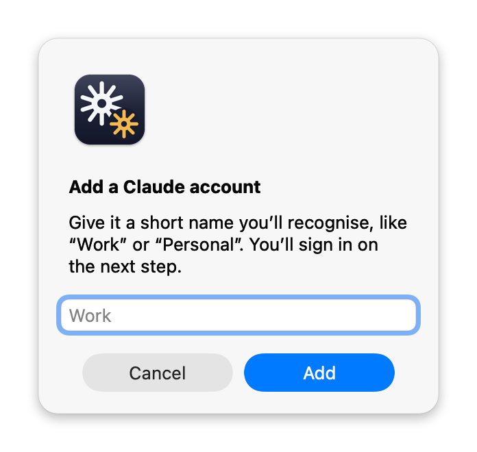
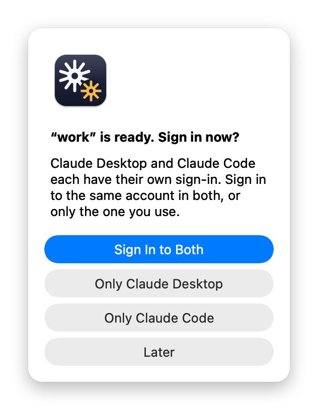
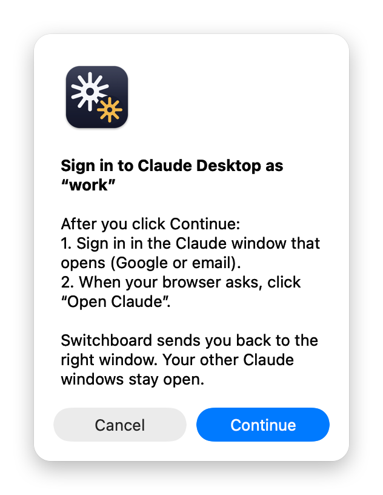
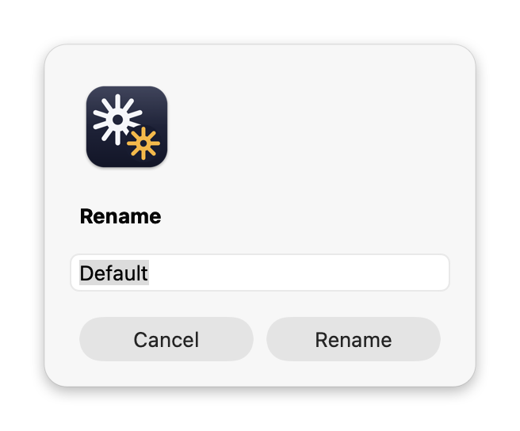

# Getting started

This guide takes you from nothing to two Claude accounts running side by side. It takes about five minutes.

## Before you start

You need:

- macOS 14 or later.
- [Claude Desktop](https://claude.ai/download), [Claude Code](https://claude.com/claude-code), or both.

Your current Claude setup stays exactly as it is. Switchboard lists it as **Default** and never moves or changes it. You can rename it, for example to "Personal".

## 1. Install

Pick one. The first two start working with the first release; until then, build from source.

**Homebrew**

```bash
brew install --cask haffaz/tap/switchboard
```

If Homebrew says the tap is not trusted, run `brew trust haffaz/tap` and install again.

**Download**

Get `Switchboard-<version>.dmg` from the [Releases page](https://github.com/Haffaz/switchboard/releases), open it, and drag Switchboard to Applications.

**Build from source** (needs Xcode 16 or later)

```bash
git clone https://github.com/Haffaz/switchboard.git
```

```bash
cd switchboard && ./build.sh --install
```

Open Switchboard from Applications if it is not already running. A two-cog icon appears in your menu bar.

To have it there after every restart, click the icon and choose **Open at Login**.

## 2. Add an account

Click the menu bar icon and choose **Add Account…**.

<p align="center"></p>

Type a short name you will recognise, such as "Work". Switchboard tidies it into a simple form: "Client: ACME Inc." becomes `client-acme-inc`.

## 3. Sign in

Switchboard asks which parts to sign in.

<p align="center"></p>

Claude Desktop and Claude Code keep separate sign-ins, even for the same Claude account. Choose **Sign In to Both** unless you use only one of them. You can do the other later from the account's menu.

### Claude Desktop

<p align="center"></p>

1. Click **Continue**. A new Claude window opens for this account.
2. Sign in there with Google or email. Claude shows a sign-in sheet, or opens your browser.
3. If your browser asks, click **Open Claude**.

When Claude has saved the sign-in, Switchboard tells you the account is ready. Your other Claude windows stay open and signed in.

**The first time**, macOS asks whether Switchboard may control Claude. Click **Allow**. Switchboard needs this to pass the sign-in to one specific Claude window. [How it works](how-it-works.md#signing-in-to-claude-desktop) explains why.

### Claude Code

A Terminal window opens and runs Claude Code's sign-in for this account. Follow its prompts, then close the window.

## 4. Everyday use

<p align="center">
  
  
</p>

- **Click an account** to open its Claude Desktop. If it is already running, its window comes to the front.
- **Point at an account** to see everything it can do: open Claude Code, open a Terminal, quit, and more.
- A **green dot** means that account's Claude Desktop is running.
- A **Sign In** badge means Claude Desktop is not signed in for that account yet.
- While the menu is open, **⌘1, ⌘2…** open Claude Desktop for the first nine accounts, and **⇧⌘1, ⇧⌘2…** open Claude Code.

### Quitting an account

Closing a Claude window does not quit that Claude. It keeps running in the background, like any Mac app. With several copies that look the same, that is easy to miss.

To stop one, point at the account and choose **Quit Claude Desktop**. When two or more are running, **Quit All Claude Desktops** appears in the main menu.

### Renaming an account

Point at an account and choose **Rename…** to change the name shown in the menu. This works for every account, including Default.

<p align="center"></p>

Renaming changes only what you see. Sign-ins, chat history and files stay where they are. Clear the field to go back to the original name.

### Telling accounts apart

Give each account its own icon: point at the account, then **Icon**, and pick one. The icon shows next to the account's name in the menu.

For a Dock icon that opens one account's Claude Desktop, choose **Add Dock Icon** in the account's menu, then drag the new app to your Dock.

## 5. Optional: use it from the terminal

If you installed with Homebrew, `cprof` is already available. Otherwise choose **Install Command Line Tool** in the menu. You can then run `cprof` in any terminal:

```bash
cprof list
```

To make plain `claude` pick the right account for each project folder, add this line to `~/.zshrc`:

```bash
eval "$(cprof init zsh)"
```

Then pin a folder to an account once:

```bash
cd ~/Projects/client-site && cprof use work
```

From then on, running `claude` anywhere inside that folder uses the `work` account. The [`cprof` guide](cli.md) covers every command.

## What is shared between accounts

Every account uses the same `CLAUDE.md`, rules, agents, commands, skills, hooks, output styles, plugins, settings and key bindings. Change them once and every account sees the change.

Each account keeps its own sign-in, chat history, projects, and MCP servers. If you use MCP servers, add them again in each new account.

[How it works](how-it-works.md) has the full list.

## Removing an account

Point at the account and choose **Remove Account…**. This signs it out of Claude Code and deletes its chat history and settings on this Mac. Your Claude account itself is not affected.

Something not working? See [Troubleshooting](troubleshooting.md).
